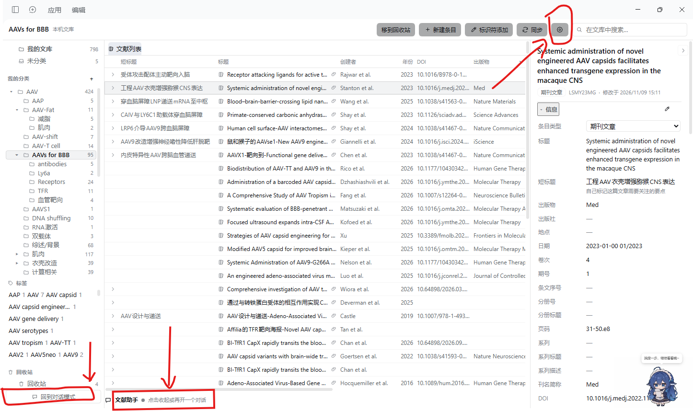
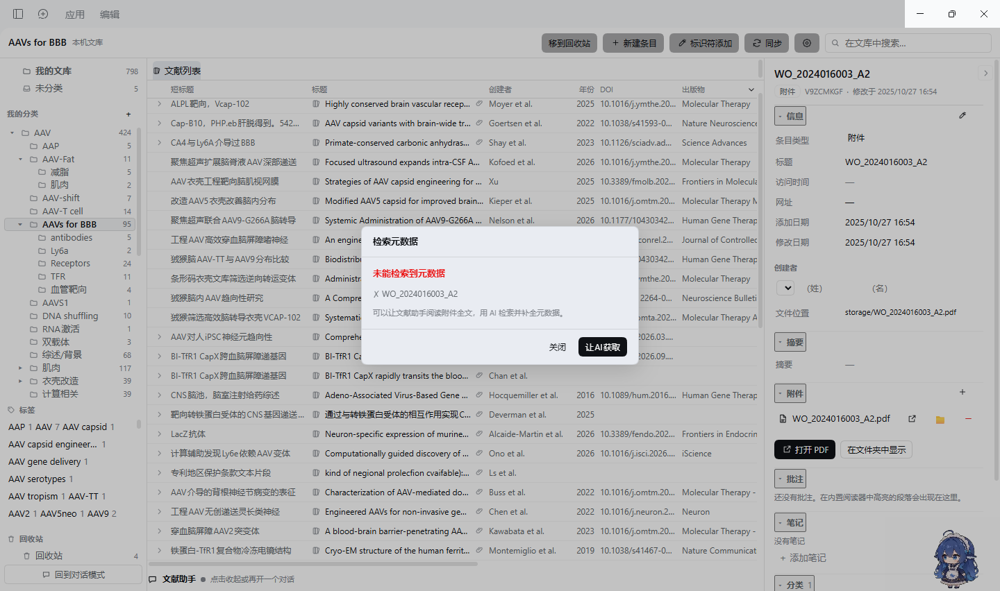
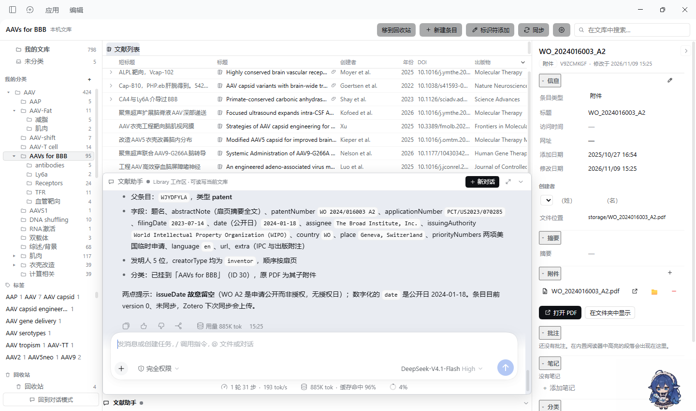
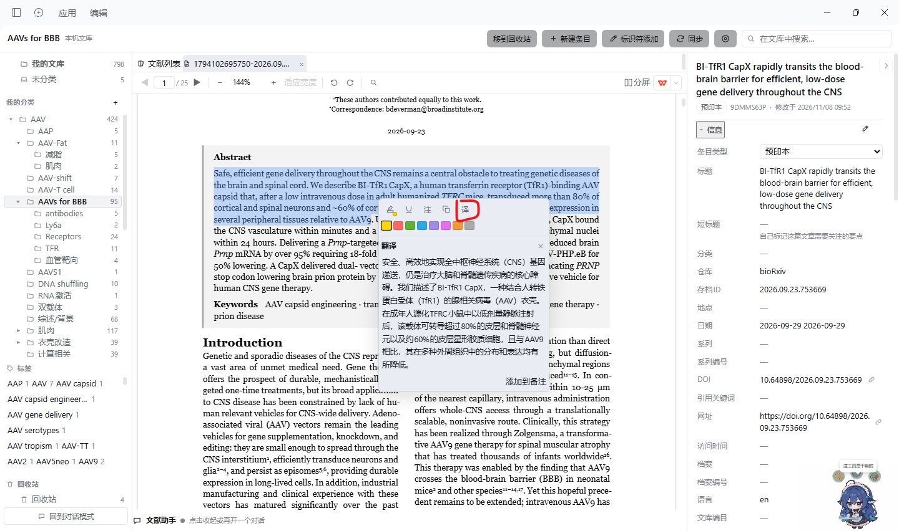
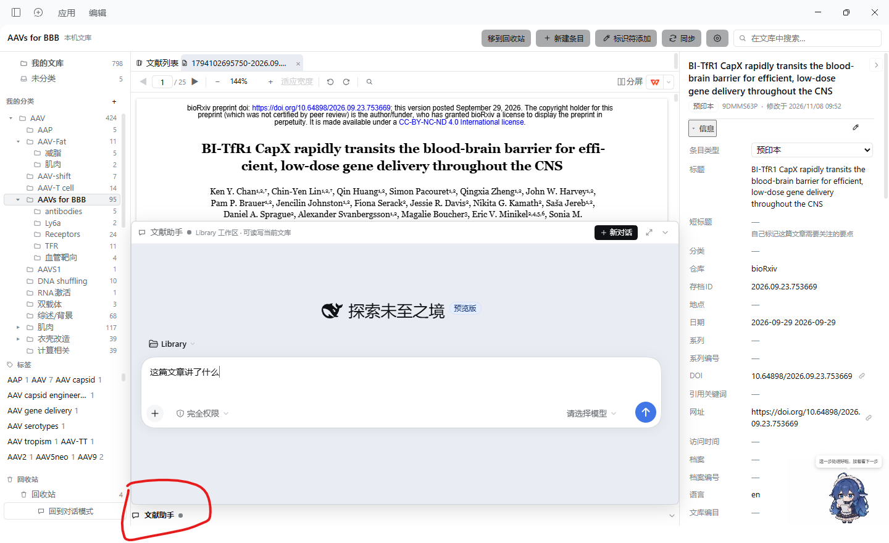
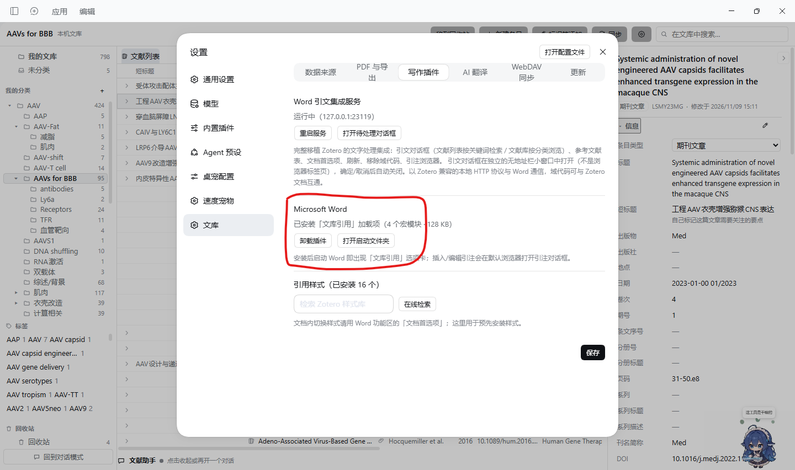
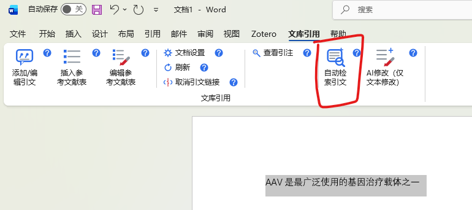
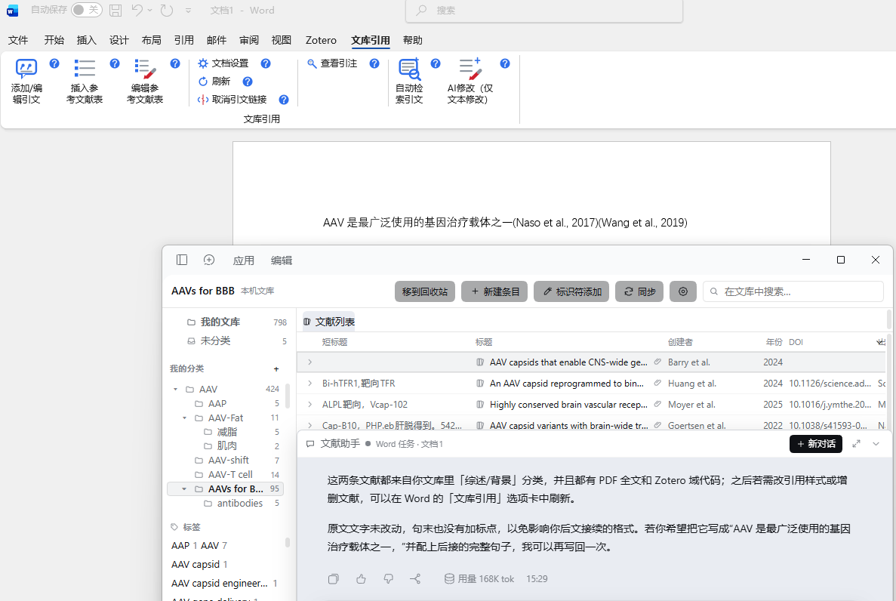
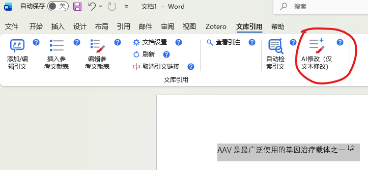
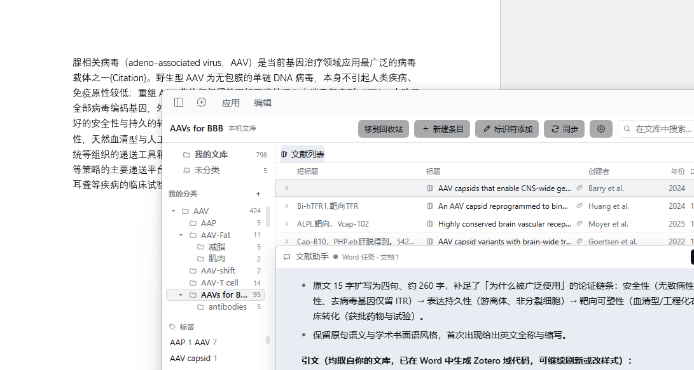

# dsh-zot-library

## 这是什么

一个面向 [DeepSeek Harness (dsh)](https://www.deepseek.com/harness/) 的第三方文献管理插件：把 **Zotero 文库**搬进 dsh。左侧栏底部一键进入 Zotero 风格的整页图书馆，直接读写你现有的 `zotero.sqlite`（没有装 Zotero 也能用独立文库），并配一个具备完整 agent 能力的「文献助手」。

## 能做什么

- **文库管理**：分类树 / 标签 / 回收站，文献列表可排序、可自定义列；条目字段、标签、分类、批注、笔记、附件全部直接写进 Zotero 数据库（写入 `synced=0`，Zotero 自身的同步照常上传）。
- **导入与元数据补全**：PDF 拖进列表即导入，按 DOI / arXiv / ISBN / PMID / 题名联网检索元数据（Crossref，摘要自动回退 OpenAlex / PubMed），补不全的一键交给 AI；只有 DOI 或题名没有文件也能建条目并联网补全。
- **阅读**：双击打开 PDF——库内内置 pdf.js 查看器（高亮 / 下划线 / 批注 / 全文查找 / 旋转 / 上下分屏平行阅读 / 划词 AI 翻译），或交给系统默认阅读器；外部阅读器新增的批注会自动回写 Zotero。没有 PDF 的条目自动改为在浏览器打开其网页链接或 DOI。
- **文献助手**：悬浮在文献列表上的对话 dock，自动跟随当前浏览 / 阅读的文献；可调用全部 `library_*` 工具检索、整理、总结文库、写笔记，也能派发「AI 补全元数据」等任务。
- **同步与导出**：完整实现 Zotero 的 WebDAV 文件同步协议，可与 Zotero 客户端共用同一台 WebDAV；全库一键导出 CSL JSON / BibTeX。
- **Word 参考文献（引文）**：完整移植 Zotero 文字处理集成——Word 功能区「文库引用」选项卡、Zotero 兼容域代码、citeproc 专业排版、CSL 样式在线检索安装；不开 Word 也能让 AI 生成带真实引文与参考文献表的 .docx 报告。
- **Agent 工具**：约 20 个 `library_*` 工具，任何 dsh 会话（不只文献助手）都能检索、阅读、修改文库并导出引用。

## 怎么安装

在 dsh 里安装（三选一），安装后**重启 dsh** 生效：

1. **npm 包名**：在 dsh 的插件安装入口填包名 `dsh-zot-library`。
2. **GitHub 地址**：填 `https://github.com/GenePad/dsh-zot-library`。
3. **让 agent 装**：在 dsh 对话里直接说——「用 plugin manager 从 https://github.com/GenePad/dsh-zot-library 安装 dsh-zot-library 插件」。

> 旧包名 `dsh-zlibrary` 已更名弃用：已安装旧版的请先在插件管理器卸载，再用新包名 / 新仓库地址重装。

## 怎么进入主界面

点击**左侧栏底部的「文库」按钮**（与设置按钮同排），主栏即切换为整页图书馆：

- 左栏：分类树 / 标签 / 回收站
- 中栏：文献列表
- 右栏：选中文献的详情（可折叠）

再次点击「文库」或切换到其他面板即返回对话模式。首次打开会询问**关联本机 Zotero**（自动定位 `zotero.sqlite`）还是**使用独立文库**（存在 dsh 数据目录，随时可在设置里切换或导出迁移到 Zotero）。

## 怎么使用

- **导入**：把 PDF（可多选）拖进中栏列表；或用工具栏魔棒按钮输入 DOI / ISBN / arXiv / PMID / 题名逐条入库。元数据不全时点导入卡上的「用 AI 补全元数据」，文献助手会联网核对并写回。

  

  

- **浏览与编辑**：左栏点分类 / 标签；中栏点选条目（Ctrl 多选、Shift 连选），表头按钮增删列、点击表头排序；右栏直接点击字段编辑（作者行可增删排序），底部各分区管理附件、批注、笔记、分类、标签。
- **阅读**：双击条目打开 PDF。库内查看器里选中文本即可高亮 / 下划线 / 批注 / 「译」AI 翻译；工具栏支持缩放、跳页、全文查找、旋转、分屏（横向 / 纵向）。

  

- **右键菜单**：条目右键可打开附件、复制 BibTeX / CSL JSON、创建副本、合并条目、检索元数据、添加到分类等。
- **文献助手**：中栏底部一行点开即浮出对话面板；「新对话」开新会话，↗ 跳到 dsh 原生对话界面继续。问文献问题时它会自动带上你正在看的内容作为上下文。

  
- **设置**（齿轮）：数据来源、PDF 打开方式（内置查看器 / 系统）、写作插件（Word 服务）、AI 翻译模型、WebDAV 地址与凭证、插件更新源（默认 GitHub 官方源，填 `off` 关闭自动更新）。
- **同步**：配置 WebDAV 后点工具栏「同步」，或开启自动同步，附件文件即与 Zotero / 其他设备互通。

## 怎么使用参考文献引文等功能

**方式一：Microsoft Word 插件（Zotero 同款体验）**

1. dsh 中打开 **设置 → 文库 → 写作插件**，点「一键安装」（只是把预构建的 `DshLibrary.dotm` 复制到 Word 启动目录，不调用 Word、无需管理员）。

   

2. **完全退出并重启 Word**，出现「文库引用」选项卡。
3. 「引文格式设置」选参考文献样式（APA / IEEE / GB-T 7714 等，未安装的可在线检索安装），然后：
   - **添加 / 编辑引文**：光标放在要引的位置，弹出的引文对话框可按关键词检索文库或按分类浏览，支持页码等定位符、前后缀，确定后引注与参考文献表**自动重算**；
   - **插入 / 编辑参考文献表**：文末一键生成，可自定义条目文本；
   - **刷新 / 取消引文链接 / 查看引注**：维护文档里的全部引文域。
4. **AI 两个按钮**（先在 Word 里选中一段文字，dsh 主窗口会自动置前）：
   - **自动检索引文**：把选中文字交给文献助手，检索本地文库为这段话配引文并写回；

   | 选中一句话，点「自动检索引文」 | 文献助手从你的文库配好引文，写回 Word（可刷新 / 换样式） |
   | --- | --- |
   |  |  |

   - **AI修改（仅文本修改）**：在 dsh 对话里写下修改要求，AI 改写（可带引文）后整段替换回 Word。

   | 选中要改的段落，点「AI修改」 | AI 按你的要求改写并写回 Word |
   | --- | --- |
   |  |  |

## License

MIT
